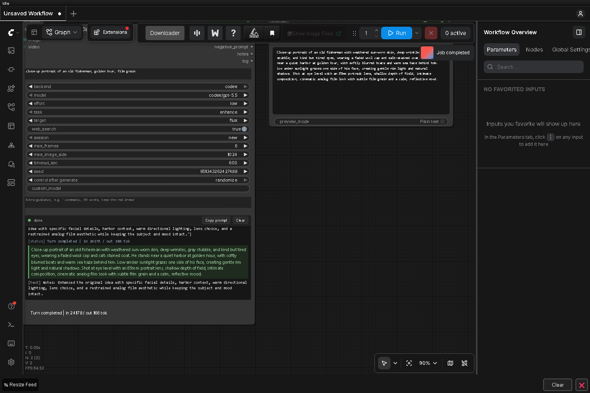

# ComfyUI-AI-Prompt-Assistant

A ComfyUI node that turns rough ideas, draft prompts, reference images and videos into polished
generation prompts, using **your own Claude Code or Codex CLI** running in the background.
It uses the login those CLIs already have (Claude subscription / ChatGPT plan), so there is no API
key and no per-token credit spend.



## Features

- **Inputs:** multiline text, optional `IMAGE` (batches are sampled), optional `VIDEO` (evenly
  sampled frames + fps/duration metadata).
- **Outputs:** `prompt`, `negative_prompt`, `notes`, `log`.
- **Backends:** `claude_code` or `codex`, chosen per node. Model dropdown filters itself to the
  backend; a `custom_model` field accepts any id the CLI understands.
- **Effort:** `default / low / medium / high / xhigh / max` → Claude `--effort`, Codex
  `model_reasoning_effort`.
- **Tasks:** `enhance` (improve or build a prompt), `describe_media` (image/video → prompt),
  `chat` (free-form answer in the `prompt` output).
- **Targets:** Flux, SDXL, SD1.5, Qwen-Image, Z-Image/HiDream, Wan, LTX, Hunyuan, Kling/Veo/Sora,
  Midjourney, custom — each with prompt-style guidance baked in.
- **Enforced research:** model/topic identification → local skill lookup → mandatory verified web
  research on a miss → prompt generation. The code checks completed search-tool events and sourced
  research output; an agent saying “I searched” is insufficient. Research failures stop the run.
- **Local skills:** shared editable Markdown files, automatic exact-version matching, a skill
  dropdown, **Refresh skills list**, and **create / refresh** actions. Learned skills include dates
  and source URLs and persist independently of temporary runs. See [skill format](skills/README.md).
- **Sessions:** `continue` resumes the node's previous conversation, so "make it moodier" works.
- **Run this node alone:** select the node and press ComfyUI's native blue **play button** in the
  selection toolbox ("Execute to selected output nodes"), or use the **▶ Run** button in the log
  header. Either one executes only the assistant (plus whatever feeds its inputs) and skips the rest
  of the workflow. Nothing is added to your canvas, and other nodes keep their caches. The node is
  still a normal (non-output) node on the server, so full-workflow queues behave as before. Like
  ComfyUI's own partial execution, a plain Run leaves the seed alone, so queueing the full workflow
  afterwards reuses that exact prompt instead of calling the CLI again. **Shift+click Run** rolls a
  new seed first to force a fresh result.
- **Live log panel** on the node: status, thinking, tool calls, searches, results, errors, with
  Stop / Clear / Copy-prompt buttons. Also streamed to the ComfyUI console.

## Requirements

- ComfyUI ≥ 0.3.60 (V3 node API + `VIDEO` type). Tested on 0.36.0 / frontend 1.52.7.
- [Claude Code](https://docs.claude.com/en/docs/claude-code) logged in (`claude auth status`) and/or
  [Codex CLI](https://github.com/openai/codex) logged in (`codex login status`).
- No extra Python packages (uses torch / numpy / Pillow that ComfyUI already has).

Developed and tested on Windows. The CLI discovery and process handling also cover Linux and macOS,
but those platforms have had less testing.

## Install

```
cd ComfyUI/custom_nodes
git clone https://github.com/sako1989/ComfyUI-AI-Prompt-Assistant
```

Restart ComfyUI and refresh the browser. You can also paste the repository URL into
ComfyUI-Manager's **Install via Git URL**, or download the ZIP and extract it into
`ComfyUI/custom_nodes/`.

## Quick start

1. Add **AI Prompt Assistant (Claude Code / Codex)** from the *AI Prompt Assistant* category.
2. Pick a `backend`, type an idea into `text`, and optionally connect an `IMAGE` or `VIDEO`.
3. Connect the `prompt` output (and `negative_prompt` if your model uses one) to your text encoder.
4. Queue the workflow, or press **▶ Run** on the node to run only the assistant.

## Configuration

If the CLIs are not on the PATH of the ComfyUI process, copy `config.example.json` to `config.json`
next to this README and adjust the paths:

```json
{
  "claude_path": "C:/Users/you/.local/bin/claude.exe",
  "codex_path": "C:/Users/you/AppData/Local/Programs/OpenAI/Codex/bin/codex.exe",
  "keep_runs": 20,
  "strip_api_keys": true,
  "extra_claude_args": [],
  "extra_codex_args": []
}
```

Every key is optional. `config.json` is git-ignored.

`strip_api_keys` (default true) removes `ANTHROPIC_API_KEY` / `OPENAI_API_KEY` from the child
environment so the CLIs use your subscription login instead of API billing.

`GET /ai_prompt_assistant/status` shows which CLI paths were resolved.

## Usage counter

The log panel includes a per-run token counter (input, output, cached input and total),
updated after each CLI call and summed across identification, research and retries.
Cached input is included in input totals, not added twice. Reported USD cost appears
when supplied by the CLI; unavailable cost is never treated as zero. These are usage
reports, not subscription credit balances or actual subscription charges. Interrupted
or missing reports are marked partial. Counters reset on a new execution; a ComfyUI
cache hit incurs no new CLI usage. Reloading the page clears the display; totals also
appear in the run log output.

## How it runs the agents (sandboxing)

The assistant first identifies mentioned models and research subjects in a separate, text-only
CLI call. The host requires research for every identified subject without a local skill, regardless
of whether the agent claims to know it. Use **generation_model** for the exact image/video model
name to guarantee that name is checked; **model/custom_model** still selects the assistant LLM.
Automatic extraction from prose is AI-based and can miss ambiguous names; code cannot inspect
an LLM's training data. Exact version input removes that dependency for the named model.

Each uncached subject gets an isolated research call and at most one verification retry. The host
requires a completed successful search event, a `verified` result, and HTTP(S) source URLs before
atomically saving a skill. These checks enforce the workflow, not the factual truth of every claim.
The final generation call has web search disabled and receives the loaded skills, keeping research
reusable. There is one timeout budget for the entire operation. Research calls do not pollute the
resumable prompt conversation. Topic identification adds one CLI call even on a skill cache hit;
it sends only the current text and prior subject names, not reference images.

With **web_search = off**, cached/manual skills still work, but a missing skill causes an actionable
error instead of an unverified model-specific answer. Plain scene requests need no research.
Skills do not expire automatically; use **refresh** when documentation changes. Editing a skill
invalidates the node cache. Creating a skill can also cause one subsequent cache invalidation.

New controls are appended to preserve the widget order of existing workflows. Restart ComfyUI
and reload the browser after updating. Add a skill file and click **Refresh skills list** to see it.

- Claude Code: `claude -p --output-format stream-json --permission-mode dontAsk --tools Read[,WebSearch,WebFetch]
  --strict-mcp-config --safe-mode --setting-sources "" --json-schema …`. File reads are limited to
  this pack's `workspace/` folder, where the reference PNGs are written, and it can (optionally) use
  the web. No Bash, no edits.
- Codex: `codex [--search] exec --json -c sandbox_mode="read-only" -c approval_policy="never"
  -c mcp_servers={} -m <model> -i <frames> --output-schema …`. The read-only sandbox blocks writes,
  but Codex can still read files and run read-only commands anywhere your account can.
- The prompt is fed via stdin; the process is killed on ComfyUI interrupt, on timeout, or via the
  Stop button. Old run folders are pruned (`keep_runs`).

## Privacy and security

- **What leaves your machine:** your text, extra instructions, the sampled reference images / video
  frames, and any loaded skill files are sent to Anthropic or OpenAI through the CLI you selected,
  under your own account and that provider's terms. Nothing is sent anywhere else, and this pack
  collects no telemetry.
- **What is stored locally:** reference media as PNGs in `workspace/runs/<id>/` (pruned to the
  newest `keep_runs`), conversation ids in `workspace/sessions.json`, and researched skills in
  `skills/learned-*/`. All three are git-ignored, as is `config.json`.
- **HTTP routes:** `/ai_prompt_assistant/status`, `/cancel` and `/skills` have no authentication of
  their own, like the rest of ComfyUI's API. `status` returns the resolved CLI paths. Do not expose
  your ComfyUI port to an untrusted network.
- **Codex can read local files.** Its sandbox is read-only, not read-nothing. With web search on, a
  hostile web page could try to talk the agent into reading a file and leaking it through a web
  request. Use the Claude Code backend, or turn `web_search` off, when you work near sensitive files.
- **Logs can contain local paths** (the run folder and the files the agent read). Check a log or
  screenshot before sharing it.
- **`extra_claude_args` / `extra_codex_args`** are appended to the command line as-is and can widen
  what the agent is allowed to do. Leave them empty unless you know what a flag does.
- **Learned skills come from web pages.** They are passed to the model as reference data, not as
  instructions, but it is still worth reading one before relying on it.

See [SECURITY.md](SECURITY.md) for how to report a vulnerability.

## Notes

- Codex: the node always passes an explicit model because a `config.toml` default newer than the
  installed CLI makes `codex exec` fail. Update Codex if you want the newest models.
- The `seed` widget only affects ComfyUI's caching. Set it to `fixed` to avoid re-running the
  assistant when nothing changed; `randomize` re-runs every queue.
- Media is downscaled to `max_image_side` and capped at `max_frames` to keep runs fast.

## Development

Run these from the pack folder with the Python interpreter ComfyUI uses (the tests need torch,
numpy and Pillow):

```
# unit tests (parsers, command building, media, prompts, sessions), runner tests (real child processes), skills
python tests/test_all.py
python tests/test_runner.py
python tests/test_skills.py

# manual end-to-end run against a real CLI (no ComfyUI needed)
python -m aipa.runner claude_code "a cat on a windowsill" [ref.png] [--task chat] [--resume ID]
python -m aipa.runner codex "a cat on a windowsill" [ref.png]
```

Design notes: [docs/DESIGN.md](docs/DESIGN.md). Python changes need a ComfyUI restart; JS changes
only need a browser reload.

## Disclaimer

This is an independent community project. It is not affiliated with, endorsed by, or supported by
Anthropic, OpenAI, or Comfy Org. "Claude", "Claude Code", "Codex" and "ChatGPT" are trademarks of
their respective owners. The node only launches CLIs you installed and logged in to yourself; you
are responsible for using them within the terms of your plan with each provider.

## License

[MIT](LICENSE)
